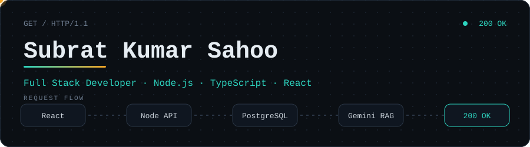

<p align="center">
  
</p>

### `GET /about`

```json
{
  "name": "Subrat Kumar Sahoo",
  "role": "Full Stack Developer",
  "location": "Bhubaneswar, India",
  "building": ["RAG helpdesk", "WhatsApp automation", "Instagram automation"],
  "highlight": "Cut API response time by ~25% with query indexing",
  "education": "MCA, Biju Patnaik University of Technology",
  "status": "open to backend and full stack roles"
}
```

### `GET /stack`

```json
{
  "backend": ["Node.js", "Express", "NestJS", "TypeScript"],
  "frontend": ["React", "Next.js"],
  "data": ["PostgreSQL", "MongoDB", "Redis", "Prisma"],
  "ai": ["LangChain", "Gemini API", "RAG", "Vector Search"],
  "integrations": ["WhatsApp Cloud API", "Instagram Graph API", "Webhooks"],
  "devops": ["Docker", "AWS EC2", "GitHub Actions"]
}
```

### `GET /projects`

| Project | What it does | Stack |
|---|---|---|
| **QuickDesk** | AI helpdesk with ticket triage and RAG-based replies | Next.js · NestJS · PostgreSQL · LangChain · Gemini |
| **WhatsApp Automation** | Campaigns, scheduling and retries for segmented contacts | Node.js · Express · WhatsApp Cloud API |
| **Instagram Automation** | Campaign engine and no-code chatbot builder | Node.js · Express · Instagram Graph API |

### `GET /activity`

<p>
  
  
</p>

### `POST /contact`

```http
POST /contact HTTP/1.1
Content-Type: application/json

{ "message": "Let's build something." }
```

<a href="https://www.linkedin.com/in/mrsubrat/"></a>
<a href="mailto:skumarsahoo470@gmail.com"></a>

<p align="center">
  
</p>
